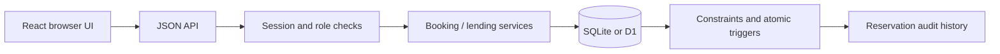
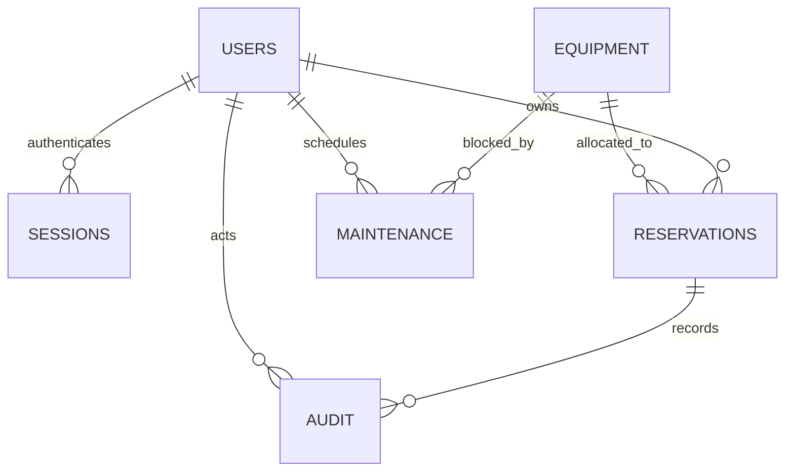
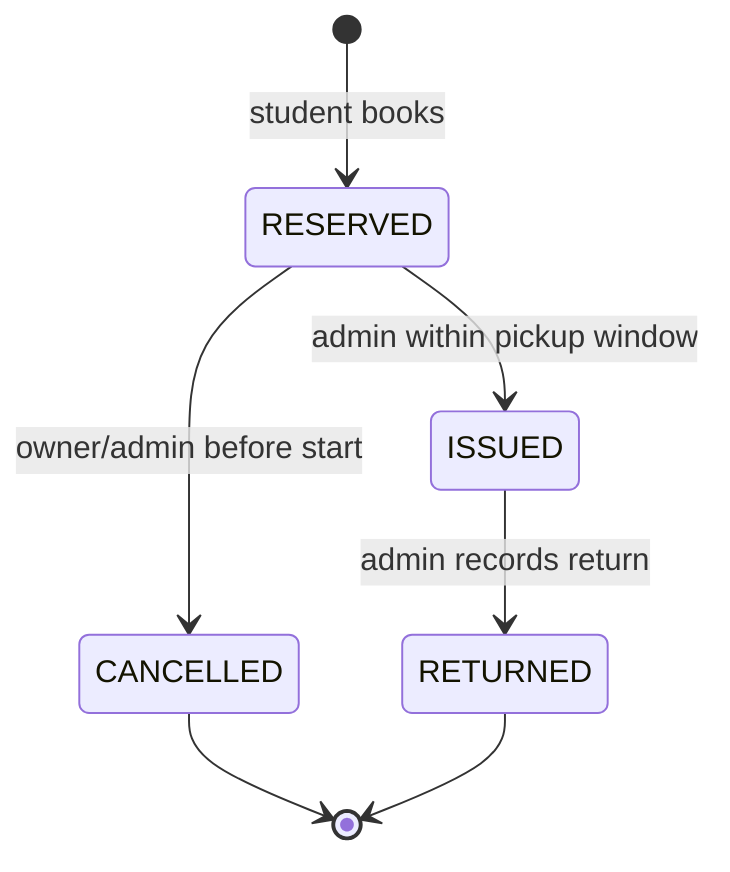

# CampusSlot architecture

## Boundary and data flow

CampusSlot is one product with two runtime adapters. React calls JSON endpoints. `lib/server/api.ts` authenticates and routes requests; `service.ts` implements domain operations. `database.ts` is the small parameterized-query interface. `sqlite.ts` adapts Node SQLite; the hosted route supplies a D1 database session pinned to the primary. SQL migrations and triggers are shared.

This separates domain rules from hosting. The standalone server serves a compiled frontend and the same API; the Worker uses Vinext to serve React and API routes. No third-party connector, AI, payments, chat or upload service is part of the product.

## Data model

| Table | Key facts |
| --- | --- |
| `users` | ID, unique normalized email, display name, student/admin role, bcrypt hash |
| `sessions` | SHA-256 hash of random bearer token, user FK, 8-hour absolute expiry |
| `equipment` | Name, category, location, description, total capacity, active/archive flag |
| `reservations` | User/equipment FKs, start/end, quantity, purpose, status, owner-scoped request key, issued/returned times, acting user |
| `maintenance` | Equipment FK, interval, reason, administrator FK; all units blocked |
| `audit` | Created/transition events inserted by triggers in the same database statement |
| `login_attempts` | Hashed normalized-email key, window start and count; no client IP storage |
| `schema_migrations` | Standalone-only ledger of applied SQL files |

Database CHECK constraints require positive capacity/quantity and valid interval lengths. Foreign keys preserve references. A unique `(user_id, request_key)` constraint provides durable idempotency. Equipment names are unique per location (case-insensitive), so a repeated create cannot silently duplicate an inventory group. Indexes cover equipment/status/time lookups. Triggers reject illegal transitions, booking conflicts, invalid numeric values, unsafe inventory changes and maintenance collisions.

## Time and interval semantics

All displayed and entered dates are IST. A `datetime-local` input is explicitly interpreted with `+05:30`; it is never interpreted using the evaluator's browser timezone. UTC epoch milliseconds are stored. IST has a constant offset, so this app does not attempt general daylight-saving timezone handling.

Intervals are half-open: **[start, end)**. A reservation ending at 12:00 does not conflict with one starting at 12:00. Start must be future, no more than 90 days away. Reservations last at most 7 days; maintenance lasts at most 30 days. There is no business-hours restriction in this fictional campus.

## Availability calculation

For a selected interval, find active RESERVED/ISSUED records that overlap it. Returned/cancelled records contribute zero. Clip each overlapping interval to the query interval and form two events: `+quantity` at start and `-quantity` at end. Sort events by time, processing end events before start events at an equal time. The maximum running total is peak usage. Available units equal capacity minus that peak, unless archived, maintained or blocked by an overdue loan.

Example: capacity 3; A uses 2 units 10:00–11:00 and B uses 2 units 11:00–12:00. A new request for 1 unit 10:00–12:00 fits: peak existing usage is 2, although total booked quantity across the window is 4. Summing all overlapping reservations would wrongly reject it.

An early issued loan begins consuming capacity at `min(start_at, issued_at)`. Issuing early cannot take units committed to another reservation or maintenance period. The current number of issued units is also checked before issue, because a borrower might return late.

Overdue loans conservatively block new reservations for the whole equipment type until returned. This simplifies uncertainty about when those units will come back; it can underutilize unaffected units, a deliberate demo tradeoff. Existing future reservations remain recorded, but the desk must check physical capacity before issuing them.

## Concurrent writes and invariants

A read-then-insert check alone is unsafe: two requests can both observe the same remaining capacity. CampusSlot's BEFORE INSERT trigger evaluates the proposed quantity **inside the database write**. SQLite serializes writers. The trigger evaluates usage at the proposed start and each relevant existing start within the interval—exactly the points at which occupancy can increase—and calls `RAISE(ABORT, 'CAPACITY_CONFLICT')` when any point exceeds capacity.

This protects different processes, not merely one JavaScript event loop. The automated race test uses 12 worker threads with separate SQLite connections and one durable database file. Only 2 one-unit insertions succeed for capacity 2. WAL and a busy timeout allow waiting writers to see committed state.

D1 uses the same SQLite schema and SQL triggers. Runtime D1 compatibility and hosted concurrency still require deployment verification; local SQLite results are not presented as a hosted benchmark. D1's `batch()` is used only for coherent multi-statement authentication/seed work. Reservation invariants and their audit event are one SQL statement plus triggers, not an application transaction spread across network calls.

State updates use `WHERE id=? AND status=?` as an optimistic guard. If two conflicting actions race, the loser updates no record and gets 409. The database independently validates the allowed transition. Exact repeated reserve requests return the existing record; a reused idempotency key with a different payload returns 409. The UI retains its key after a network error and disables controls during submission. Repeating an already-completed identical state transition is a safe no-op.

## Authorization and security

| Operation | Student | Administrator |
| --- | --- | --- |
| Browse equipment/availability | Yes | Yes |
| Create reservation | Own account only | No; use a student demo account |
| Read reservations/audit | Own only | All |
| Cancel | Own RESERVED before start | Any RESERVED before start |
| Issue/return | No | Yes, subject to state/time/capacity |
| Equipment/maintenance mutations | No | Yes |

Unknown or another student's reservation returns 404, avoiding a resource-existence leak. Permission checks execute on the server even if a caller manually constructs an API request. User IDs and roles come from the session join, never client JSON. SQL is parameterized. React escapes displayed user text.

Passwords use bcryptjs cost 10. Sessions use cryptographically random 256-bit tokens; only a SHA-256 token hash is stored. Cookies are HttpOnly, SameSite=Strict, Path=/ and Secure on HTTPS. Logout deletes the session. Expired/forged tokens fail. POST/PATCH/DELETE require the exact same Origin, JSON and a custom request header; the API does not enable cross-origin CORS. API responses are `no-store`. Login failures share a generic message, with an atomic account-based 20-attempt/15-minute limit.

These are public demo accounts, not production identities. The hosted private Site also enforces its own platform sign-in. There is no sign-up, role mutation, password reset, email notification or real institutional SSO. The demo bootstrap only creates fixed fictional records and refuses a populated database; it cannot reset reservations or choose arbitrary credentials.

## Lifecycle

Issue window: `[start − 15 minutes, end)`. Overdue is a computed label on ISSUED, not an extra stored state. A missed RESERVED booking is displayed as EXPIRED after end, consumes no future capacity, and cannot be issued or cancelled. There is no scheduled background job or silent status rewrite.

## Maintenance and inventory policy

Maintenance blocks every unit, rejects overlap with RESERVED/ISSUED records or another maintenance period, and also rejects unresolved overdue equipment. It never silently cancels a student's booking. Admins choose a different interval or explicitly cancel an eligible booking first. Issued equipment must be returned. Maintenance periods are immutable: remove and recreate to change one.

Quantity reductions and archiving are blocked when any future RESERVED record or ISSUED loan exists. This deliberately avoids complicated capacity-reduction rescheduling. Increasing capacity and descriptive edits are allowed. Archive preserves history and removes equipment from student discovery.

## Tradeoffs and limits

- Aggregate quantities rather than individually serialized physical assets; no damaged/missing-component assessment.
- A single campus timezone and public fictional demo identities.
- Conservative blocking for overdue loans; no waitlist or automatic reallocation.
- Latest 500 reservations shown; no large-campus pagination/reporting.
- SQLite serializes writes; appropriate for a small lending desk, not a globally distributed high-write booking service.
- No email, notifications, password reset, file uploads, realtime push, or real campus enrolment.
- Vinext is a beta hosting adapter. A standalone Node runtime is supplied so evaluation can proceed independently.
- Browser/mobile rendering, HTTP serving in this sandbox, remote D1 migration execution and deployed persistence are pending due environment restrictions.

## Reference documentation

- [SQLite trigger semantics](https://www.sqlite.org/lang_createtrigger.html)
- [Cloudflare D1 SQL support](https://developers.cloudflare.com/d1/sql-api/sql-statements/)
- [D1 database methods and batches](https://developers.cloudflare.com/d1/worker-api/d1-database/)
- [bcryptjs implementation and API](https://github.com/dcodeIO/bcrypt.js)

These references support the platform choices; the product rules and implementation are original to this project.
